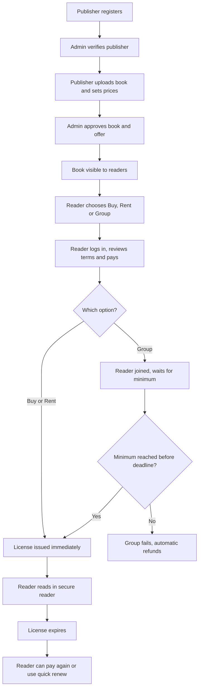

# Kitab: System Overview

A plain-language description of how Kitab works, written for developers who are new to the project. It explains **what the system does and the rules it follows**. It does not describe database tables, API design or code structure.

---

## 1. What is Kitab?

Kitab is a web platform where people read digital books legally, and where readers can **pool together** to unlock a lower price per person.

- It is open to **every kind of book and every kind of reader**. It is not limited to students or textbooks.
- Publishers and writers list their books. Each book is approved by the platform admin before readers can see it.
- A reader can **buy**, **rent**, or **join a group** to get access to a book.
- Every reader gets their **own individual license**, read in a secure online reader that carries their personal watermark.

**Kitab is a licensing platform, not a file-sharing platform.** Nobody downloads and passes on a file. Access always belongs to one paying account.

---

## 2. Who uses the system

| Role | What they do |
|---|---|
| **Reader** | Browses books, buys, rents or joins a group, pays, and reads in the secure reader. |
| **Publisher / Author** | Registers, gets verified, uploads books and sets the price options for each book. |
| **Admin** | Verifies publishers, approves books and offers, creates groups, handles payments, refunds, complaints and abuse. |
| **Payment gateway** | External service that takes payments and sends refunds. |
| **Email service** | External service that sends notifications. |

Notes:
- A person registers as a reader or as a publisher/author. Publisher accounts cannot list anything until the admin approves them.
- Only the admin can create groups. Readers cannot create groups. They can only join.

---

## 3. Key concepts

### 3.1 Offers
Each approved book can have up to three ways to get access. The publisher sets the prices.

| Offer | Description |
|---|---|
| **Individual buy** | One reader pays the highest price and gets access for the long term, with a limited number of devices for that same reader. |
| **Individual rent** | One reader pays a lower price for a fixed period (for example 30, 90 or 180 days). |
| **Group access** | Several readers each pay a lower per-person price. Access works only if enough readers join before the group deadline. |

Price order the system must always respect: **group price per person < rent price < buy price.** Other pricing ideas are suggestions shown to the admin, not blocking rules. The publisher decides prices.

### 3.2 Groups
- A group belongs to **one book**, and has a **minimum** and a **maximum** number of readers (the minimum can never be less than 2).
- There is **one active group per book at a time**. When it fills up, a new group opens automatically with the same conditions. A waitlist covers readers who arrive while a new group is being set up.
- **Private groups** are different. They are created by the admin on demand, after the publisher gives permission and full payment is received. The admin then shares a private link.
- A group has two time limits:
  - **Joining deadline:** join before this date, or the group fails and everyone is refunded.
  - **Access period:** how long each reader can read after getting a license (for example 6 or 9 months).

### 3.3 License
- A license is the reader's right to read one book.
- It has an issue date, an expiry date, a device limit and reading rules.
- The **access period starts on the day the license is issued.** Two readers in the same group can have different expiry dates if they got their licenses on different days.

### 3.4 Price lock
Once a reader pays, the price they agreed to cannot change.

---

## 4. Overall flow

---

## 5. Detailed flow

### Stage 1: Publisher joins
1. The publisher/author registers and submits verification details.
2. The admin reviews and approves or rejects (with a reason).
3. Nothing can be listed until the publisher is approved.

### Stage 2: Book submission
4. The approved publisher uploads the book file, cover, title, author, category, description and preview pages.
5. The publisher also provides proof of rights for the book.
6. The admin checks the book and the proof, then approves or rejects it.
7. Only approved books are shown to readers. Nothing is trusted just because the publisher says they own it.

### Stage 3: Offers and groups
8. The publisher sets the offers for the book: buy, rent and/or group.
9. For group access the publisher sets the price per person, the minimum and maximum readers, the joining deadline and the access period.
10. Each offer can also carry **reading rules**: number of devices, and whether printing or copying is allowed.
11. The admin approves the offer. The first group for the book opens automatically.
12. For a private group, the admin creates it on demand (see section 3.2).

### Stage 4: Reader finds a book and joins
13. Anyone can browse and search by title, author, category or publisher without logging in.
14. A book page shows the cover, description, author, publisher, category, preview pages and the available offers. For groups it shows the current status, such as "12 of 30 joined", the joining deadline and the access period.
15. When the reader chooses an option, they are asked to log in or register (with email verification), then return to the same book.
16. Before paying, the reader reviews the price, access period, device limit and reading rules, and accepts the terms. For a group, it clearly says the money is refunded only if the group fails.
17. The reader pays through the payment gateway. The price is locked from this moment.
18. After payment:
    - **Buy or rent:** access starts immediately.
    - **Group, minimum not yet reached:** the reader is marked "joined" and waits.
    - **Group, minimum already reached:** the license is issued immediately.
19. **No cancellation after payment.** The only refund path is a failed or cancelled group (see Stage 5).
20. A reader can join groups of different books at the same time, but cannot join the same book's group twice while they still have access.

### Stage 5: Group result
21. The system counts only readers who have actually paid.
22. **Minimum reached:** the group becomes successful. Every paid reader gets a license, an email and an in-app message, and the book appears in their library. Readers who join later get a license as soon as they pay.
23. **Maximum reached:** the group closes to new joiners, and a new group opens automatically with the same conditions.
24. **Deadline passes below the minimum:** the group fails. Every paid reader is refunded automatically to the original payment method. The refund is started within **2-3 working days**, and the email says the money may take a little longer to show in the bank. The reader is offered buy or rent instead.
25. **Group cancelled** (for example, a rights problem or an admin decision): treated like failure. Refunds are made, and any licenses already issued are revoked.

### Stage 6: Reading
26. The reader opens **My Library**, which lists active licenses with book, expiry date and status.
27. Before opening a book, the system checks that the reader is logged in, owns the license, the license is active and not expired, and the device limit is not exceeded.
28. The file is delivered through a **temporary link that expires after a few minutes**. There is no permanent public link to any book file.
29. Each page shows a **watermark** with the reader's name, email and license ID.
30. Reading is **online only** in this version. There is no offline download.
31. The reader's last page and bookmarks are remembered.
32. Every access is recorded (time, device, IP address) so the admin can check for abuse.
33. On the expiry date, access ends. Reminder emails are sent a few days before expiry (for example 7 days and 1 day), with the renew option.
34. After expiry, the reader can pay again and join a group, or use the **quick renew** option (limited-time access after a group has closed).

### Stage 7: Money and problems
35. All reader payments go to the platform's payment gateway account first. Publishers are never paid directly.
36. For every payment the system records: the gross amount, the gateway fee, the platform commission and the publisher's net share. Commission is stored **per publisher**.
37. Publishers are paid on a **monthly or quarterly cycle**, stored per publisher. A payout covers completed sales up to the cut-off date, and the publisher receives a statement with book-wise sales, commission and net amount. The admin checks the numbers against the gateway before sending it.
38. Group money is not counted as payable while the group is still waiting, because it may need to be refunded.
39. **Reader problems** (wrong file, book not opening, double charge): the admin investigates using payment and access records, then fixes the issue, refunds, or rejects the complaint with a reason.
40. **Bank disputes (chargebacks):** the amount is held and the admin responds with proof. If lost, it is deducted from the publisher's future payout.
41. **Copyright complaints:** the admin records the complaint, pauses new joins for that book and asks the publisher for proof of rights.
    - **Upheld:** the book and its groups are taken down, licenses are suspended, affected readers are compensated (see below) and the publisher may be blocked.
    - **Rejected:** the book goes back live and the complainant gets a reason.
42. **Takedown compensation:** the first aim is to prevent this by strict checking. When it still happens, the reader is compensated with longer access, another book or credit. Cash is refunded where the law or the payment provider requires it.
43. **Reader abuse** (sharing, too many devices, unusual access): the admin warns or suspends the license. The reader gets a chance to explain before a suspension becomes permanent.

---

## 6. Group status life cycle

A group moves through these states:

| State | Meaning |
|---|---|
| Draft | The admin is setting it up. |
| Pending approval | Waiting for the admin's approval. |
| Active | Readers can join and pay. |
| Successful | Minimum reached, and licenses have been issued. |
| Full | Maximum reached. A new group takes over. |
| Failed | Deadline passed below the minimum. Refunds are made. |
| Cancelled | Stopped by the admin or because of a rights issue. Refunds are made. |
| Closed | Joining deadline over and the group is finished. |

---

## 7. Notifications

Notifications are sent **inside the app** (shown on the book page and in the library) and **by email**.

| When | Message to the reader |
|---|---|
| Payment received | Receipt and group status. |
| Group halfway to its minimum | Progress update. |
| Joining deadline within 3 days | Reminder with the number of readers still needed. |
| Group successful | License issued, with a link to read. |
| Group failed or cancelled | Refund started, with buy or rent options. |
| License near expiry | Reminders at 7 days and 1 day, with the renew option. |
| License suspended | Reason and how to respond. |

The admin and the publisher are also notified about important events such as approvals, group results, complaints and payouts.

---

## 8. Business rules at a glance

- Every book must be approved by the admin before readers can see it.
- Every publisher must be verified by the admin before listing anything.
- Prices are set by the publisher. The only enforced order is **group < rent < buy**.
- Minimum group size is at least 2.
- Only the admin creates groups. Readers can only join them.
- One active group per book. A new one opens automatically when it fills.
- A reader cannot join the same book's group again while their access is active.
- No cancellation after payment. Refunds happen only when a group fails or is cancelled.
- Prices are locked once a reader has paid.
- Licenses are issued as soon as the minimum is reached. The access period starts on the issue date.
- Reading is online only, with a watermark, a temporary file link, a default limit of **2 devices per license** (the publisher can change it) and an access log.
- Publishers are paid on a monthly or quarterly cycle. Commission is stored per publisher.
- Gateway fees are fixed by the gateway, and they are recorded with every payment.

---

## 9. Edge cases the system must handle

1. **Last seat, two readers paying at the same time.** The seat is held for a short time (for example 10 minutes) while a reader pays. If the payment fails or times out, the seat is released. The reader who loses is moved to the next group automatically, with no charge.
2. **Reader joins a group while access is still active for the same book.** Not allowed. The page shows "You already have access until [date]".
3. **Reader pays but closes the browser.** The payment gateway notifies the system in the background, so the reader is still marked as joined and is not charged twice.
4. **The same payment event arrives twice.** It must be processed only once.
5. **Group fills up while readers are still paying.** Readers who could not get a seat go to the new group.
6. **Group fails after readers have waited.** Automatic refunds and an email with buy or rent options.
7. **License expires while the reader is reading.** The reader is told, and access ends cleanly.

---

## 10. Out of scope for this version

- Mobile apps
- Offline reading and downloads
- Commercial-grade DRM
- Readers creating their own groups
- Tiered pricing that changes as more readers join
- Multiple currencies
- AI features and shared annotations

---

## 11. Open decisions

These points are not final and need an answer before or during development:

- What the admin checks before approving a publisher or writer (for example ID proof, publishing agreement, ISBN, or a sample of the work).
- The price and duration rules for **quick renew** after a group closes.
- The default length of the seat-hold time while a reader pays.
